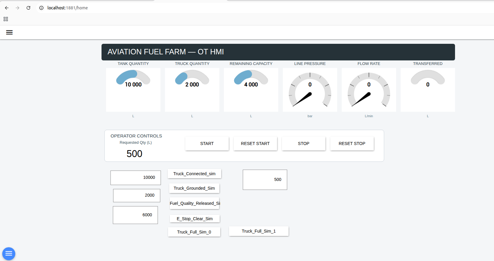
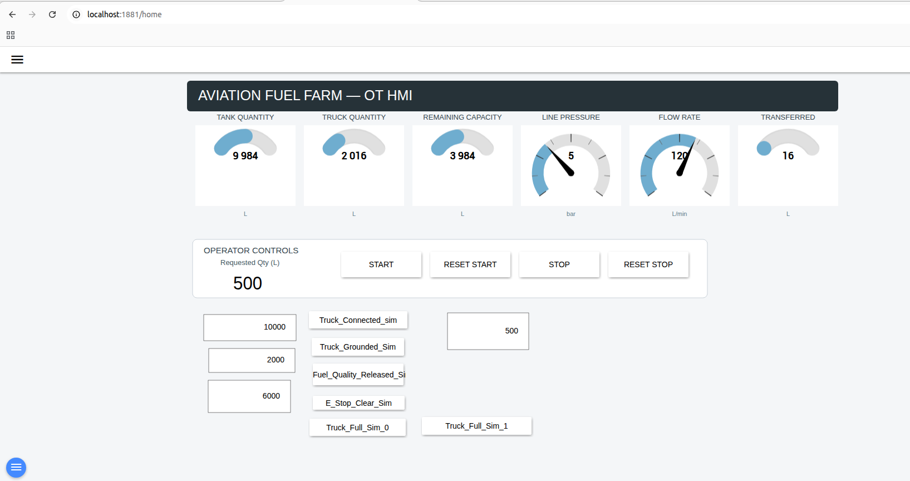

# HMI Overview

## Purpose

The HMI provides the operator interface for monitoring and controlling the simulated aviation fuel transfer process.

FUXA is used as the HMI platform and communicates with OpenPLC over Modbus/TCP.

## Main Process Displays

The HMI displays the following live process values:

- Tank Quantity
- Truck Quantity
- Remaining Capacity
- Line Pressure
- Flow Rate
- Transferred Quantity

These values are read directly from the PLC through Modbus/TCP.

## Operator Controls

The operator can:

- Enter the requested transfer quantity
- Issue START
- Reset the START command
- Issue STOP
- Reset the STOP command

The PLC still decides whether the transfer is permitted.

The HMI does not bypass PLC permissives or interlocks.

## Simulation Controls

Additional controls are used for lab testing of simulated field conditions such as:

- Truck connected
- Truck grounded
- Fuel quality released
- Emergency stop clear
- Truck full

These controls exist only to support the simulation and validation environment.

In a real OT system, these conditions would typically originate from field devices, safety circuits or external process logic.

## Normal Operation

During a valid transfer, the HMI shows:

- Line pressure at approximately `5 bar`
- Flow rate at `120 L/min`
- Tank quantity decreasing
- Truck quantity increasing
- Transferred quantity increasing

The transfer automatically stops when the active batch target is reached.

## Security Role

The HMI represents an authorized control-system client.

During the hardening phase, FUXA communication to the PLC remained allowed while unauthorized Modbus/TCP access from Kali Linux was blocked.

This demonstrated that security controls could restrict unauthorized access without disrupting legitimate operator communication.

## HMI Evidence

### Idle State

The HMI below shows the process in a normal idle condition with process values initialized and no active fuel transfer.

### Active Transfer

The HMI below shows an active transfer with changing tank and truck quantities, line pressure at 5 bar, flow rate at 120 L/min, and transferred quantity increasing.

