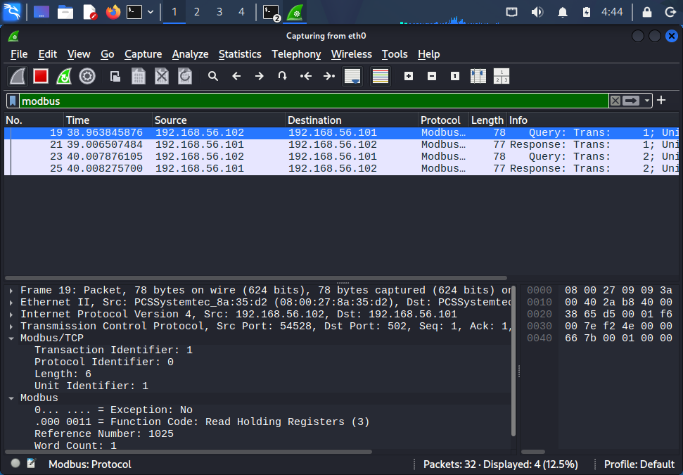
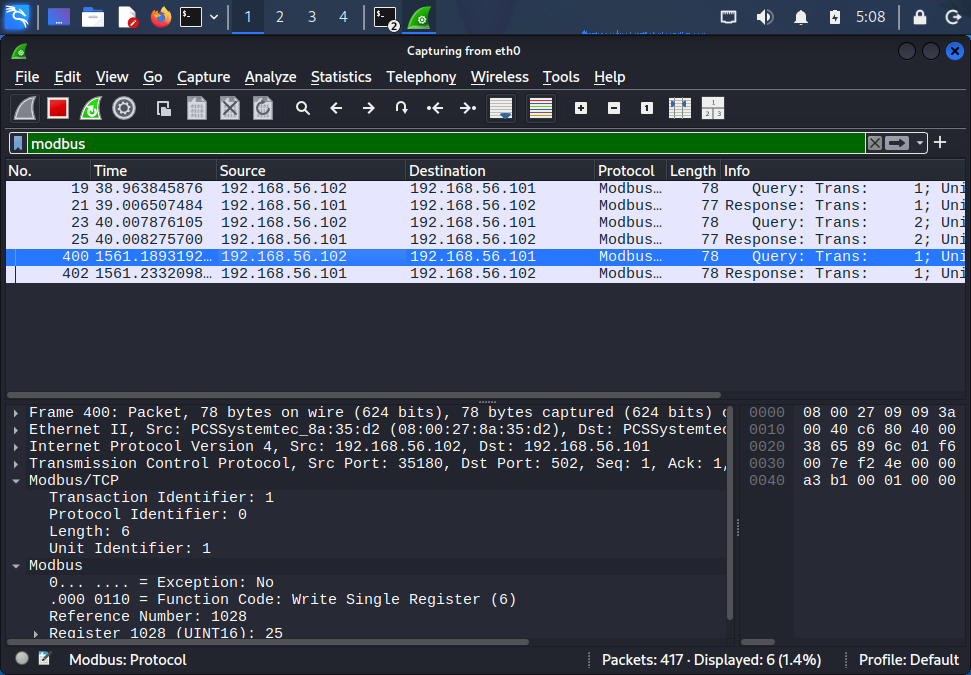

# Wireshark Analysis

## Purpose

Wireshark was used to observe Modbus/TCP communication between the Kali Linux host and OpenPLC.

The objective was to connect network traffic with actual PLC register access and process behavior.

## FC3 - Read Holding Registers

A Modbus read was generated using `mbpoll`:

```bash
mbpoll -m tcp -a 1 -r 1026 -c 1 -t 4:int16 192.168.56.101
```

Wireshark identified the request as:

- Protocol: Modbus/TCP
- Function Code: `FC3 - Read Holding Registers`
- Unit ID: `1`
- Register reference: `1025`
- Word count: `1`

The PLC response returned the requested register value.

## FC6 - Write Single Register

A Modbus write was generated using:

```bash
mbpoll -m tcp -a 1 -r 1029 -t 4:int16 192.168.56.101 75
```

Wireshark identified:

- Function Code: `FC6 - Write Single Register`
- Register reference: `1028`
- Written value: `75`

The PLC response echoed the register address and value, confirming that the write was accepted.

## Addressing Observation

`mbpoll` uses 1-based register references while the Modbus PDU displayed in Wireshark uses 0-based addressing.

Example:

`mbpoll 1029 -> Wireshark reference 1028`

This distinction was important when mapping observed network traffic to PLC variables.

## START Command Observation

The simulated START register was written using a `0 -> 1` sequence.

`mbpoll` reference:

`1040`

Wireshark reference:

`1039`

The Modbus write resulted in a valid START edge in the PLC when all required permissives were satisfied.

## Network-to-Process Relationship

The packet captures demonstrated the full path:

```text
Modbus Write
     |
     v
PLC Register Change
     |
     v
PLC Control Logic
     |
     v
Process Response
```

Examples included:

- Setpoint modification
- Unauthorized START command
- Interlock manipulation
- Process-data manipulation

## Security Observation

The baseline Modbus/TCP communication did not require authentication before register reads or writes were accepted.

A host with network access to the PLC service could therefore interact directly with process-control data.

This observation formed the basis for the later attack scenarios, risk assessment and firewall hardening.

## Packet Capture Evidence

### FC3 - Read Holding Registers

The following capture shows a Modbus/TCP Read Holding Registers request generated from the Kali VM.



### FC6 - Write Single Register

The following capture shows a Modbus/TCP Write Single Register request targeting a process register in the OpenPLC system.



## Security Observation

These captures demonstrate that Modbus/TCP requests are transmitted without built-in authentication at the protocol level.

In the baseline lab configuration, a host with network access to TCP port 502 could issue valid Modbus read and write requests directly to the PLC.

The hardened configuration therefore restricts access to TCP/502 using source-based firewall rules.