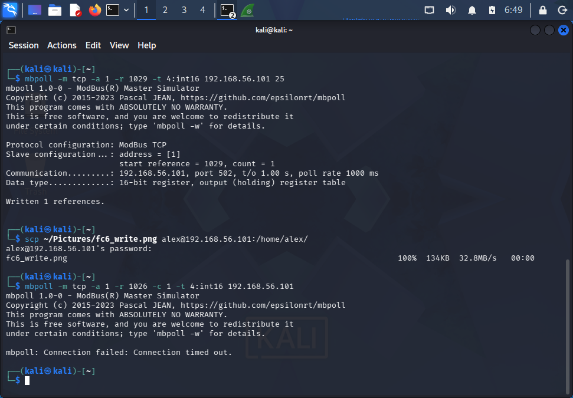
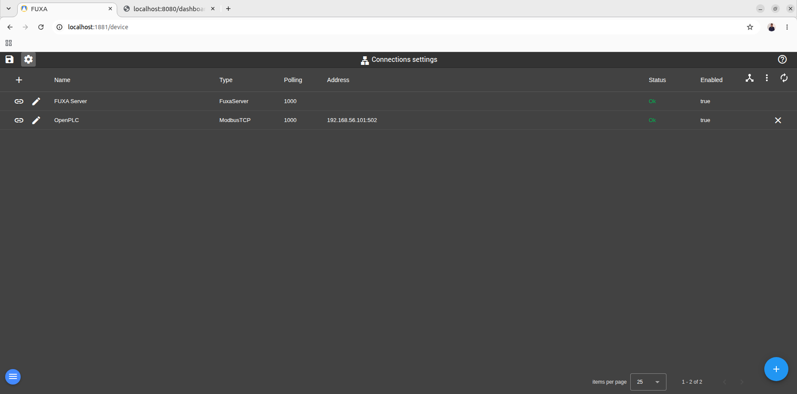

# Validation Results

## Summary

| Test ID | Validation Area | Result |
|---|---|---|
| VAL-R1 | Unauthorized Setpoint Manipulation | PASS |
| VAL-R2 | Unauthorized START Command | PASS |
| VAL-R3 | Runtime Interlock Manipulation | PASS |
| VAL-R4 | Sensor / Process Data Integrity Manipulation | PASS |
| MON-01 | Unauthorized Modbus Access Detection | PASS |
| RES-01 | Invalid Setpoint Handling | PASS |
| RES-02 | Request Exceeds Truck Capacity | PASS |
| RES-03 | Request Exceeds Tank Quantity | PASS |
| RES-04 | No Automatic Restart After Trip | PASS |
| RES-05 | Active Batch Setpoint Isolation | PASS |

## Security Validation

### VAL-R1 – Unauthorized Setpoint Manipulation
Before hardening, Kali could modify `Requested_Qty` through Modbus/TCP.

After source allowlisting was applied, the same connection attempt timed out and the setpoint was not modified.

**Result:** PASS

### VAL-R2 – Unauthorized START Command
Unauthorized START writes from Kali were blocked after hardening.

No START edge reached the PLC and the transfer did not begin.

**Result:** PASS

### VAL-R3 – Runtime Interlock Manipulation
Unauthorized modification of `Truck_Full_Sim` was blocked.

No attacker-induced process shutdown occurred.

**Result:** PASS

### VAL-R4 – Sensor / Process Data Manipulation
Unauthorized modification of `Tank_Quantity` was blocked.

No false tank-empty condition reached the PLC.

**Result:** PASS

## Monitoring Validation

### MON-01 – Blocked Modbus Access Detection
UFW logged blocked connection attempts from `192.168.56.102` to TCP/502.

Evidence:
`./evidence/logs/01_ufw_blocked_attempts.log`

**Result:** PASS

## PLC Resilience Validation

### RES-01 – Invalid Setpoint Handling
`Requested_Qty = 0` was rejected and the process remained idle.

**Result:** PASS

### RES-02 – Request Exceeds Truck Capacity
A requested quantity larger than the truck's remaining capacity was rejected.

**Result:** PASS

### RES-03 – Request Exceeds Tank Quantity
A requested quantity larger than the available tank quantity was rejected.

**Result:** PASS

### RES-04 – No Automatic Restart After Trip
After a `Truck_Full` trip was cleared, the process remained stopped until a new START command was issued.

**Result:** PASS

### RES-05 – Active Batch Setpoint Isolation
Changing the live setpoint during an active batch did not alter the latched batch target.

The transfer completed at the original target.

**Result:** PASS

## Validation Evidence

### Unauthorized Modbus Access Blocked

### Authorized HMI Access Preserved

### Firewall Logs

`./evidence/logs/01_ufw_blocked_attempts.log`

## Conclusion

The hardened configuration successfully blocked unauthorized Modbus/TCP access while preserving authorized HMI-to-PLC communication.

The validation demonstrated:

- Prevention of unauthorized PLC access
- Detection through firewall logging
- Preservation of legitimate HMI availability
- PLC resilience against invalid and mid-process input conditions